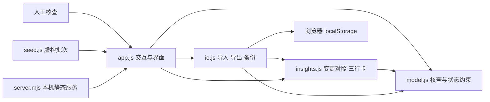
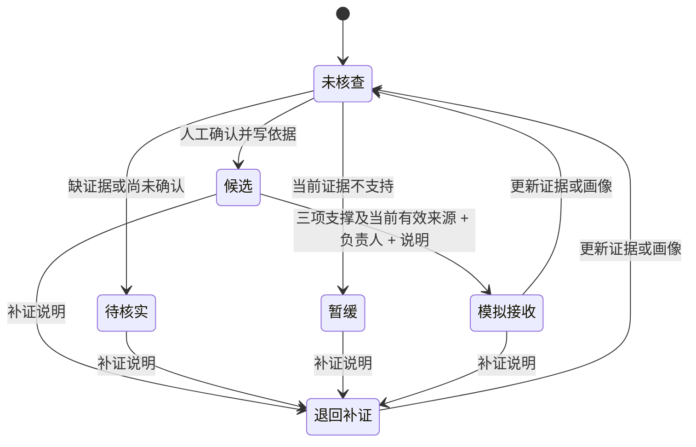

# 架构设计、模块规格与分工

## 目的与选择

这是一份可本地运行的业务系统原型。选择原生 HTML、CSS、JavaScript ES Modules：无需构建即可查看，运行无需第三方库，数据处理路径易检查。Node.js 只提供本机静态服务。测试与录制使用 Playwright，不属于运行依赖。

界面依赖规则和 I/O；规则层不依赖 DOM、网络或存储。默认浏览器通过 CSP 禁止外部连接。没有服务器写入接口、数据库和模型 API。

## 模块规格

| 模块              | 输入                       | 输出与职责                                                                      | 失败处理                                                         |
| ----------------- | -------------------------- | ------------------------------------------------------------------------------- | ---------------------------------------------------------------- |
| `seed.js`         | 无                         | 版本化虚构批次，覆盖不同核查情形                                                | 每次创建全新对象，重置不复用已修改对象                           |
| `model.js`        | 企业字段、证据、批次观察日 | 日历校验、原文支撑与来源有效性、规则建议、核查与交接状态机、结构校验、HTML 转义 | 结构错误抛出明确错误；缺证据返回待核项，不写成无需求             |
| `insights.js`     | 企业、证据变更或当前画像   | 变更字段与前后快照、撤回旧结论、三行卡                                          | 无实际变化不记录、不撤回；卡片不推断预算、用量或采购意愿         |
| `io.js`           | CSV / JSON 文本、原批次    | CSV 解析、事务式合并、去重、备份恢复、证据包和结果导出                          | 文件校验失败不改原批次；公式保护；存储损坏保留原文               |
| `app.js`          | 用户操作、规则结果         | 队列筛选、原文定位、画像与证据编辑、人工确认、模拟交接、批次进度                | 用户可理解的错误提示；先保存成功再更新内存；跨标签页冲突暂停写入 |
| `style.css`       | 屏幕尺寸、系统减少动态偏好 | 桌面工作台与手机布局、焦点样式、证据定位反馈                                    | 窄屏堆叠，表格独立滚动，不依赖动画理解信息                       |
| `server.mjs`      | GET / HEAD 请求            | 只提供应用与演示静态资源，绑定 127.0.0.1                                        | 非允许路径 404，非读取方法 405，不暴露工作目录与 Git             |
| `tests/`          | 虚构样本和边界数据         | 规则、导入、安全、状态、浏览器流程的回归证据                                    | CI 失败保留浏览器 trace，不能把检查脚本存在当已通过              |
| `record-demo.mjs` | 本地应用                   | 独立浏览器上下文的实际交互录像与截图                                            | 断言关键状态；失败停止，不拼接伪造的完成界面                     |

## 数据契约

`Batch { version, id, name, asOf, companies, events }`。本原型一次只处理当前批次。

`Company` 包含唯一技术编号、人工提供的去重标识、企业名、地区、场景、主体状态、用途类型、服务关系、证据列表、人工结论、核查时间、交接状态、负责人及说明。

`Evidence` 包含独立编号、来源类型、标题、发布日期、采集日期、链接、摘录、支撑项、主体是否对应、日期是否冲突。支撑项由人核实；引用了具体证据编号，不是模型推断出来的可信度。

`Event` 包含企业编号、操作类型、时间与说明。新增证据及画像事件可带 `comparison { before, after, fields }`：快照记录规则建议、三项原文支撑数、来源有效性、人工结论和交接；字段仅保存实际差异。旧版事件无快照则不提供对照，版本 1 备份兼容。所有对照经白名单与长度校验后保存。原型由单个本机操作者操作，日志不具备防篡改保证；生产不能沿用这种审计方式。

限制：每批 500 家、2000 条证据，每家 50 条，单证据摘录 5000 字，单文件 5 MB。结构校验只保留支持字段，不接受任意对象作为渲染数据。

## 业务状态与计算

人工可以保留与建议不同的判断，但交接的资料完整度要求不放松。证据或画像实际变化、重新核查会撤回旧交接状态；保存未变化字段保留原结论和交接。历史事件保留；这不等于撤销实际销售任务，因为原型从未连接销售系统。

规则分两层：首先根据人工标注、原文及主体对应，记录主体、具体用途、外部服务关系三项内容支撑；缺日期、过期或链接待补不会抹掉已有内容。其次检查各项支撑是否分别具有当前有效来源（日历、链接、采集顺序、演示窗口、主体及日期冲突）。新官网不能替唯一过期的 API 原文续期。三项支撑和来源核查均满足才建议候选，模拟交接还需人工确认、负责人和说明。不按来源数量加分，也不代表采购意愿。

新增/编辑与 CSV 导入共用 `applyEvidenceChange`，画像共用 `applyProfileChange`。记录真实字段差异，保存前后规则快照，并撤回旧人工判断。三行卡直接读取这些已录入字段及证据编号，明确用量、预算、采购时间均未采集；不是模型生成或真假核验。

当前状态按企业去重统计；已核查、候选、接收可以重叠，不乘成连续漏斗。新增商机未知。缺口分布也可重叠，不能相加当总企业数。

## 持久化与导入事务

1. 深拷贝当前批次进行更改。
2. 校验完整结构及交接前置条件。
3. 写入 `localStorage` 成功后才替换当前内存状态。
4. 存储满或被禁止时，提示未保存，原批次保持。

CSV 先整批解析校验再确认保存。同一企业标识但名称或画像冲突时拒绝整批导入，不覆盖旧画像。新增证据使旧判断失效。恢复或重置前另存 `evidence-desk.v1.previous`；用户也可下载 JSON。损坏原文不被自动种子覆盖。跨标签页不做自动合并，收到 storage 变化时暂停写入。

## 安全与生产演进

- 无外部请求、无密钥、无公司内部数据。只把转义后的用户文本放入界面。
- 来源 URL 仅接受 HTTP/HTTPS，拒绝带账号密码的 URL，不自动打开；CSV 导出防公式执行。
- 这不是加密存储、认证系统或多人协作。生产需要服务端权限、并发版本控制、可信审计、来源校验、数据留存策略；还要明确业务评分与接收口径。
- 后续可将 `io.js` 的存储接口替换为 API，将规则模块放在服务端统一执行；先核实需求，不在本原型里模拟已上线能力。

## 分工与贡献

| 参与者 | 实际分工                                                                                      |
| ------ | --------------------------------------------------------------------------------------------- |
| Welt   | 提供业务问题与背景资料、设定参赛目标与边界，授权 AI 自主计划和实现，保留最终评审权            |
| Codex  | 阅读资料与比赛 PDF、提出本次设计取舍、实现界面与规则、编写并运行测试、录制演示、整理文档与 PR |

原型由上述两方协作完成。`v0` 是初始文档基线，Git 提交保留计划、实现、修正与验证记录。
